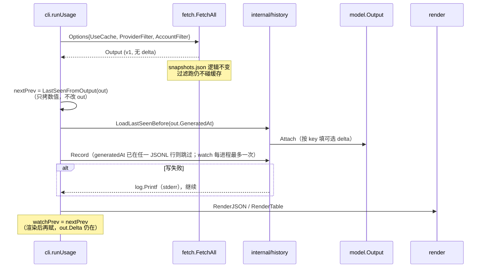
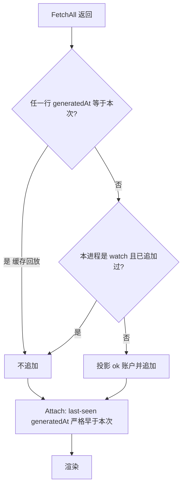

# leeway：逐次运行历史与相对上次增量（Delta）

| 字段 | 值 |
|---|---|
| 状态 | Draft |
| 作者 | Grok (design-only) |
| 日期 | 2026-09-09 |
| 范围 | `leeway usage` 的本地历史记录 + 相对上次观测的增量；以及 UI 形态取舍 |
| 非范围 | 不改生产代码；本文只设计 |

> **边界变更（2026-10）**：本文写于 2026-09-09，当时「不做 GUI / 菜单栏 / 常驻」是产品边界。
> 窗口界面此后已实现（见 [GUI.md](GUI.md)），菜单栏与常驻也不再是禁止项；当前实现仍只有窗口进程，关窗即退出。
> 下文按当时记录保留，涉及该边界的判断均已过时。

---

## Overview

`leeway usage` 今天只展示**这一次探测**的官方窗口。60s 的 `snapshots.json` 是防抖缓存，不是历史：换一次 `--provider` 都不会读写它，`--watch` 只清屏重绘。用户已经能在一张分组表里看到 Cursor / DeepSeek / Grok / OpenCode Go 的多账号窗口，但无法回答「和上次相比烧了多少」。

本设计加一条**很小、agent 友好**的本地增量：每次真正探测成功的 `usage` 把无密钥摘要追加到 `~/.cache/leeway/history.jsonl`；下一次按 `(provider id, account name, window id)` 对齐，在表格同一行和 JSON 的可选 `delta` 里给出百分点或金额差。窗口重置（本窗 `ResetsAt` 前跳；无 `ResetsAt` 的**非余额**窗，且同账户**百分比**兄弟已前跳、本窗数值下降；孤儿百分比 ≥50pp / 花费窗回落到 ~0）标记为 `reset`。余额 / 剩余（`Used` 无 `Limit`，且 id 不是 `day-*`）永不因兄弟跳变或数值回落而被标成 `reset`。产品边界不变：纯 CLI，stdout 只出数据，不引入 TUI / WebUI / 菜单栏，也不恢复 CodexBar 的成本曲线和 pace 预测。（已过时：GUI 已实现、菜单栏与常驻不再是禁止项，走势也已进窗口，见文首说明；pace / 用满预测仍然不做。）

---

## Background & Motivation

### 当前链路（已核对源码）

```
cmd/leeway/main.go
  └─ cli.Run → cli.runUsage          # internal/cli/cli.go:74
        └─ fetch.FetchAll            # internal/fetch/fetch.go:144
              ├─ 60s snapshots.json  # 仅无 --provider/--account 时读写
              └─ model.Output v1
        └─ render.RenderJSON | RenderTable
```

- JSON 契约在 `internal/model/model.go`：`Output.Version = 1`，字段名与 tag 是公开接口，改名必须 bump。
- 人看的表在 `internal/render/render.go`：TTY 上色；多账号时 provider 做组头、tag 缩进；每个账号只画自己的窗口（没有共享 5h/周/月网格）；百分比窗口用 8 格盲文条 + `DurationShort` 倒计时；金额窗口走 `money()`。
- `snapshots.json`（`fetch.go:373–472`）：TTL `CacheTTL = 60s`，指纹 `cacheFingerprint` 覆盖已启用 provider **和凭据哈希**；过滤跑既不读也不写（`fetch_test.go: TestFetchCacheKeying`）；写失败 `log.Printf` 后继续。
- `--watch N`（`cli.go:121–133`）：TTY 上 `\x1b[H\x1b[2J` 重绘，无按键；每次循环仍走 `FetchAll`（受 60s 缓存约束）。
- `modernc.org/sqlite` 只服务 cookie 导入器，与用量历史无关。
- `docs/DESIGN.md` §1 明确砍掉：菜单栏 / SwiftUI、成本历史图表、历史 pace 预测。`docs/COMPETITORS.md` 把 OpenUsage.sh 的 daemon、定价表、本地 JSONL 账单列为「不该学」。

### 痛点（对应当前表）

用户现在的人读输出已经能扫账号和窗口，缺的是：

1. **没有「上次」**：两次 `leeway usage` 之间 Monthly 93%→95%、Included $388→$400，表上只剩绝对值。
2. **重置会被误读**：若只做 `ΔusedPercent`，窗口清零会显示成大额绿色「下降」。
3. **60s 缓存不是历史**：缓存命中时 `GeneratedAt` 不变；过滤跑不进缓存；不能拿 `snapshots.json` 当上一笔。

这些都可以在现有 `model.Output` + `RenderTable` 上用可选字段解决，不必换 UI 壳。

---

## Goals & Non-Goals

### Goals

1. 记录每一次**有意义的探测 run**（定义见 §A），本地、有上限、零密钥。
2. 在表格和 JSON 中给出相对**该窗口上次成功观测**的增量。
3. 正确识别窗口重置，避免把重置渲染成省额度。
4. JSON v1 字段名不变；delta 只以 `omitempty` 附加。
5. 历史写入失败不得让探测失败（与 `saveSnapshotCache` 同一姿势）。
6. 给出明确的 UI 建议：继续打磨当前表，而不是上 TUI / WebUI / 原生 UI。

### Non-Goals

- **不**做 GUI、菜单栏、常驻进程、本地 HTTP 服务、bubbletea TUI（见 Key Decisions；若将来要改产品边界，见 Open Questions，默认仍是否）。（已过时：GUI 已实现、菜单栏与常驻不再是禁止项，见文首说明；本地 HTTP 服务仍未做。）
- **不**恢复 CodexBar 成本曲线、sparkline、pace / 耗尽预测、告警。
- **不**把 `snapshots.json` 扩成时序库，也不用 sqlite 做用量仓。
- **不**做独立的 `history` 子命令或 `usage --since` 回放。走势是 `usage --last`。
- **不**把 error 字符串、cookie、token、fingerprint（`cacheFingerprint` 含凭据）写入历史。
- **不**发明未实现的 provider。
- **不**为理论上的恶意 JSONL 做解析器级防御；坏行跳过即可。

---

## Proposed Design

### 总流程



历史包**不**进入 `FetchAll`。探测编排与 60s 防抖保持现状；CLI 在拿到 `Output` 之后、渲染之前接线。这样 `fetch_test.go` 的缓存契约不用为历史改语义。

### A. History

#### A.1 什么是一次 run

一次 run = `cli.runUsage` 里一次 `fetch.FetchAll` 返回的 `model.Output`。

| 情况 | 是否写入 history.jsonl | Attach 对照谁 |
|---|---|---|
| 网络探测，账户 `status=ok` 且有 Snapshot | 是 | `generatedAt < out.GeneratedAt` 的按 key 最后一次 ok 观测 |
| 探测得到 `error` / `not_configured` | **否**（整账户不写） | 该账户不更新 last-seen；下次成功仍对齐更早的成功观测 |
| `snapshots.json` 缓存命中（`out.GeneratedAt` 已在 JSONL **任一行**） | **否** | 同上：last-seen **严格早于** 这个 `generatedAt`（重放当初那一笔的 delta，不是和后来的过滤跑比） |
| `--no-cache` | 是（这是新探测） | 严格早于本次 `generatedAt` |
| `--provider` / `--account` 过滤跑 | 是（今天过滤跑本来就不走缓存，是真探测） | 只写入出现过的 key；其它 key 的上次观测不变 |
| `--watch` 第一次探测 | 是（若不是缓存命中） | 第一 tick 走磁盘 `LoadLastSeenBefore` |
| `--watch` 同进程后续 tick | **否** | 进程内 `LastSeenFromOutput(上一 tick)`，不扫盘 |
| 未知 provider 等导致 `FetchAll` 返回 error | 不写（没有 Output） | — |

不把缓存命中当成新 run：它只是同一笔 `GeneratedAt` 的回放（`loadSnapshotCache` 原样返回 `file.Output`）。

**Record 去重（不是看末行）：** 扫 JSONL，若**任一行**的 `generatedAt` 与本次 `out.GeneratedAt` 相等（`time.Time.Equal`），跳过追加。末行相等不够：全量 T1 之后若来了一笔过滤跑 T2，T2 变成末行；60s 内再全量会命中 `snapshots.json` 仍带 `generatedAt=T1`，末行却是 T2，末行判断会把 T1 再写一遍。不给公开 JSON 加 `cached` 字段；200 行扫描足够。

**Attach 在缓存回放上必须用「严格早于本次 generatedAt」的 last-seen（方案 b），不要和「当前值自己」比出全 0。** 这样 `leeway usage --json` 在 60s TTL 内与当初那次探测的 `delta` 一致。若改成和 T1 自己比，agent 会看到 delta 突然消失。第一次跑（JSONL 里没有更早的行）仍然省略 delta。

反例（末行去重 + 全局 last-seen 会翻车）：

1. 全量 T1 写入 history 与 `snapshots.json`（Cursor Monthly 93%→95%，delta `+2`）。
2. `leeway usage --provider cursor` 在 T2 真探测，Cursor 已到 96%，成为 JSONL 末行。
3. 60s 内再全量：缓存命中，`generatedAt=T1`（仍是 95%）。末行是 T2 → 误追加第二笔 T1；全局 last-seen 让 Cursor 拿 95% 对 96%，画出 **↓1 / 绿**——和真实方向相反。
4. 正确：Record 因 T1 已在文件中某处而跳过；Attach 用 `generatedAt < T1` 的观测，Cursor 仍是 `+2`。

`--watch` 必须单独限制。否则 `CacheTTL` 过后每 60s 一条，隔夜约 1.4k 行，会把「本地小 JSONL」做成时序后端。Live 增量改走内存即可，`--watch` 已经在清屏重绘。

#### A.2 路径与格式

- 目录：`auth.CacheDir()`（`internal/auth/auth.go:40`），即 `~/.cache/leeway/`，`LEEWAY_CACHE` 可覆盖。
- 文件：`history.jsonl`（**新文件**，禁止写入 `snapshots.json` / `cookies.json`）。
- 权限：目录 `0700`，文件 `0600`（与 `saveSnapshotCache` / `config.Save` 一致）。
- 一行一条 JSON object，UTF-8，无密钥投影结构（内部 `fileRecord`），**禁止** `json.Marshal(model.Output)`（`AccountResult.Error` 可能含服务端原文）。

```json
{
  "v": 1,
  "ts": "2026-09-09T06:32:01Z",
  "generatedAt": "2026-09-09T06:32:01Z",
  "watch": false,
  "providerFilter": "",
  "accountFilter": "",
  "entries": [
    {
      "provider": "cursor",
      "account": "work",
      "windows": [
        {"id": "primary", "usedPercent": 95.0, "resetsAt": "2026-09-17T04:00:00Z"},
        {"id": "auto", "usedPercent": 71.0},
        {"id": "included", "used": 400.0, "limit": 400.0, "currency": "USD"}
      ]
    },
    {
      "provider": "deepseek",
      "account": "default",
      "windows": [
        {"id": "primary", "used": 396.68, "currency": "CNY"}
      ]
    }
  ]
}
```

字段约束：

- `provider`：`ProviderResult.ID`（`cursor` / `deepseek` / …），不用 `DisplayName`。
- `account`：`AccountResult.Name`（tag / 订阅名 / `default`），**不用** `Identity.Account` 邮箱。邮箱是 PII，且 `--account` 过滤的主键是 Name。
- 窗口只留 `id` + 数值 + `resetsAt` + `currency`。**不存 `title`**（Grok 的 Weekly/Monthly 会随 `currentPeriod.type` 变；对齐靠 id）。
- 不存 `error`、`Identity`、plan、指纹、cookie、token、API key。
- `Snapshot.Cost`：仅当本包的 `costDuplicatesWindow`（见下，**不** import `internal/render`）为假时另存一条合成窗口 `id = "cost"`（OpenCode Go 的 Zen balance）。DeepSeek 的 Cost 与 `primary` Balance 重复，只存窗口，也不给 `Cost.Delta`。

#### A.3 与现有窗口 id 的对齐（源码现状）

Join key = `(provider, account, window.id)`。各家现用 id：

| Provider | 稳定 id（代码） |
|---|---|
| cursor | `primary`（Monthly %）、`auto`、`included`（美元）、`credits` |
| deepseek | `primary`（Balance）、`day-YYYY-MM-DD`（平台 token 增强） |
| grok | `primary`、`ondemand` |
| kimi | `primary`、`secondary`、`kimi-monthly`、`kimi-code-7d` |
| codex | `primary` / `secondary`（按窗口时长归位），以及 `codex-spark` / `codex-spark-weekly` |
| opencode-go | `primary` / `secondary` / `tertiary` / `renewal` |
| commandcode | `primary` / `secondary` / `tertiary`（常为 `$used/$cap`） |

Title 只用于展示。Cursor 的 Included 是窗口不是 Cost；DeepSeek Balance（`primary`）是 `Used` 无 `Limit` 的余额；DeepSeek `day-*` 把当日 token 写在 `Used` 上、无 `Limit`，**不能**走余额极性（见 §B.2）；Command Code 5h/周经常是 `Used+Limit` 花费窗。Delta 极性见 §B.3。

#### A.4 保留 / 轮转

- 上限 **200 条 run**（不是 200 个窗口）。单条约 1–3 KiB，满载约 0.2–0.6 MiB。
- 追加后若超过 200 行：同一把锁下重写，只留最新 200 行。
- 不做按天的时序裁剪（少一个时钟策略）。200 次交互 `usage` 对单机 CLI 足够；watch 不按 tick 追加。
- 坏行：`json.Unmarshal` 失败则跳过该行，不中止 Load。
- 这是本地工具，不是 metrics 后端；不压缩、不上传、不做索引库。

#### A.5 与 `snapshots.json` 隔离

| | `snapshots.json` | `history.jsonl` |
|---|---|---|
| 职责 | 60s 防抖，避免重复打官方 API | 跨 run 的上次观测 |
| 谁写 | 仅无过滤且 `UseCache` | 探测成功的账户投影 |
| 指纹 | SHA-256(凭据) | 无 |
| 失败 | 非致命 | 非致命 |
| 过滤跑 | 不读不写 | 写已探测到的 key |

禁止把历史塞进 `snapshotCacheFile`。两者 TTL、覆盖范围、内容敏感度都不同。

#### A.6 `--no-cache` / `--watch` / 过滤

- `--no-cache`：`UseCache=false`，必探测，必尝试追加（watch 后续 tick 除外；`generatedAt` 已在文件中则仍跳过）。
- 过滤：写入本次出现的 ok 账户；`LoadLastSeenBefore(t)` 扫描**全文件**，只收 `generatedAt < t` 的行，按 key 后写覆盖。因此 `leeway usage --provider cursor` 的 Monthly delta 对齐的是上次看到该 cursor 账户该窗口的时候（可能是一次全量跑），而不是「上一条 JSONL 整对象」。
- `--watch`：见 A.1。第一 tick：磁盘 `LoadLastSeenBefore`。之后：`watchPrev` 来自上一 tick 的 `LastSeenFromOutput`（数值拷贝，**不**修改即将渲染的 `out`），不扫盘。



#### A.7 失败策略

与 `saveSnapshotCache`（`fetch.go:196–200`）相同：

```go
if err := history.Record(...); err != nil {
    log.Printf("history: write failed (data is still valid): %v", err)
}
```

Load 失败：当「无历史」处理，不打 delta，不把 usage 退出码改成 2。stdout 仍是完整探测结果。

#### A.8 并发

两个 `leeway usage` 同时跑是现实路径（人看表 + agent `--json`）。

- 对 `history.jsonl` 做 Unix `flock` 排他锁（macOS/Linux；leeway 的 cookie/keychain 路径本就以 macOS 为主）。
- 临界区：扫文件看是否已有本次 `generatedAt`（任一行，去重）→ 追加一行 → 必要时轮转重写。
- 拿不到锁：等最多 ~200ms，然后放弃写入（非致命）。Delta 仍尽量用无锁读到的内容计算；最坏是这次没记下，下次 delta 跨过这一笔。
- 不引入 sqlite WAL。`config.Save` 的 tmp+rename 适合整文件替换；JSONL 追加用 flock 更直接。
- 丢一条历史不是 P0；**把密钥写进 JSONL 才是 P0**（投影结构 + 测试，见 Security）。

#### A.9 `usage --last`

只读命令 `leeway usage --last N [PROVIDER [ACCOUNT]] [--json]`：把 JSONL 里近 N 次画成盲文点阵（4 行 × 每样本一列），窗口重置处断开。不访问网上的 provider，不是交互 TUI，也没有 `--since` 分页。

---

### B. Delta vs last run

#### B.1 对照物：按 key 的上次成功观测，不是「上一条 run 整包」

用户口中的「相对上次」在多账号 + 过滤跑下，正确语义是：

> 这个 `(provider, account, window id)` 上一次 **ok** 时的数值。

若用「JSONL 上一条整对象」：全量 → `--provider cursor` → 全量，第二次全量里 Grok 会对空。按 key 扫描可避免。

实现：`history.LoadLastSeenBefore(t time.Time) map[Key]Obs`，从旧到新扫 JSONL，**跳过 `generatedAt >= t` 的行**，后写覆盖。新探测与缓存回放共用这一函数：对照物永远是「比当前这张 Output 更早的观测」，缓存回放不会拿 T2 过滤跑当 T1 的上次。Watch 后续 tick 不走磁盘，用 `LastSeenFromOutput` 的内存 map。

`Key`：结构体 `{Provider, Account, Window}`（对齐键 = provider id + account tag + window id）。

账户改名（tag 变了）视为新账户：无 delta。不靠邮箱对齐（历史不存邮箱）。

#### B.2 百分点 vs 金额

| 窗口形态 | 判定（已有字段，**不**新加 `kind`） | Delta | 例子 |
|---|---|---|---|
| 百分比 | `UsedPercent != nil` | `curr - prev`，**百分点**，不是相对比例 | 93%→95% = `+2`，不是 `+2.15%` |
| 花费（有上限） | `Used != nil && Limit != nil` | `curr.Used - prev.Used`，原币种 | Cursor Included $388→$400 = `+$12.00` |
| 余额 / 剩余 | `Used != nil && Limit == nil`，且 id **不是** `day-*` | 同上，绝对值 | DeepSeek `primary` ¥396.68→¥380.00 = `-¥16.68`；Zen；Grok `ondemand` |
| DeepSeek 当日 token | `id` 以 `day-` 开头（`Used` 无 `Limit`，但是用量不是余额） | 按**花费**：`curr.Used - prev.Used`；上升为烧 token | `day-2026-09-09` 1e6→1.2e6 = 红 `+200000`。昨天的 `day-*` 消失则省略（B.5），不编 0 |
| 仅倒计时 | 只有 `ResetsAt`（OpenCode `renewal`） | **不计算**用量 delta | 省略 |
| Cost 脚注 | 未与窗口重复的 `Snapshot.Cost`（`costDuplicatesWindow` 为假） | `Amount` 差，当余额 | Zen balance。DeepSeek 与 `primary` 重复则 **Attach 也不写 `Cost.Delta`** |

JSON 里百分比差放在 `delta.usedPercent`（含义：对 `usedPercent` 的增量，单位 pp）。金额差放在 `delta.used`。

绝对值小于阈值视为 0 并省略：`|pp| < 0.05`，`|amount| < 0.005`。不展示 `+0`。缓存回放走方案 b，会重放当初的非零 delta，不是这里的省略路径。

#### B.3 极性（颜色含义）

| 形态 | 数值上升 | TTY 颜色 |
|---|---|---|
| 百分比额度（用得越多越糟） | 坏 | 红 ↑ / 绿 ↓ |
| 花费窗 Included / Command Code `$used/$cap` / DeepSeek `day-*` | 坏 | 红 ↑ / 绿 ↓ |
| 余额 DeepSeek `primary` / Zen / Grok `ondemand` cap | 好（充值） | 绿 ↑ / 红 ↓（花费） |
| `reset` | 非「变好」 | 灰色文案 `reset`，不用绿 |

非 TTY：不用箭头，ASCII `+2.1` / `-16.68` / `reset`。盲文条保持现状（本来就不是 ASCII）。

#### B.4 窗口重置（必须写死的规则）

用量回落**不等于**省了额度。OpenCode Go 的 `ResetsAt` 每次都是 `now + resetInSec`（`opencodego/provider.go:190`），会随时间**后移变近**，不能把任何 `ResetsAt` 变化当重置。

Cursor `included` / `credits` 是 `Used`+`Limit` 且 **没有** `ResetsAt`（`cursor/fetcher.go` 只给 `primary` Monthly 填 `BillingCycleEnd`；grants 无重置时刻）。轻用量月切 `$50 → $0` 相对 `$400` cap 只有 12.5%，「回落 ≥ 50% limit」**抓不住**，会把切账画成绿色退款。这是强 P1，不是边角。

权威仍是规则 1。对**本窗没有 `ResetsAt`** 的行，加一条同账户例外，但必须落在已经声明的极性上，而不是「同账户任意兄弟一跳，所有无 `ResetsAt` 的行都 reset」：

- **规则 2 的目标窗**：百分比（`UsedPercent != nil`，Cursor `auto`）或花费（`Used != nil && Limit != nil`，Cursor `included` / `credits`）。切账后已经重新花钱（`$50 → $60`）则数值上升，走普通花费 delta，不标 reset。
- **规则 2 明确排除剩余余额**：`Used != nil && Limit == nil` 且 id 不是 `day-*`（DeepSeek `primary`、Grok `ondemand`、Command Code 无 cap 的 `tertiary`、OpenCode Zen / 合成 `id:"cost"`）。这些下降是花钱，桶没有「从零开始」。`day-*` 仍按花费极性算数字 delta，但 DeepSeek 没有百分比兄弟可跳，规则 2 实际打不到它。
- **`siblingPercentJumped` 只统计百分比兄弟**（`UsedPercent != nil` 且 `resetsAtJumped`）。Cursor 上这就是 Monthly `BillingCycleEnd`。Command Code 的 5h `$used/$cap` 前跳**不能**传染 `tertiary` 剩余。不写 `provider == "cursor"`：极性才是不变量，硬编码家名会在下一扇无 `ResetsAt` 的花费窗上漏掉切账。

50% limit 规则删掉。孤儿兜底只留：百分比 ≥50pp；花费窗（必须有 `Limit`）回落到 ~0。余额窗不走规则 2、3、4。

若不加余额排除，规则 2 会在本仓库里把花钱标成 `reset`（JSON `{ "reset": true }` 无金额，agent 会以为桶清零了）：

1. Grok `ondemand`（`grok/provider.go:108`，剩余 cap，无 `Limit` / `ResetsAt`）挨着带 `ResetsAt` 的 `primary`。周/月切账时 primary 前跳；同期 on-demand `2500→2400` 会被标 `reset` 而不是红 `-$100`。
2. Command Code 无 cap 的 `tertiary`（`parser.go:176–186`，`Used` 无 `Limit`）挨着带 `ResetsAt` 的 5h `primary`。每次 5h 滚动都是 ~5h 前跳；剩余因花费下降会被标 `reset`。
3. OpenCode Zen / `id:"cost"` 无 `ResetsAt`；rolling 真重置时 `ResetsAt` 前跳 ~5h。百分比窗自己有 `ResetsAt`、走规则 1；Zen 若走规则 2 会把余额花费标成切账。

```go
const resetForwardSlack = 5 * time.Minute
const usedNearZero = 0.005 // 与「省略 +0」同一量级

func resetsAtJumped(prev, curr obs) bool {
    return prev.ResetsAt != nil && curr.ResetsAt != nil &&
        curr.ResetsAt.After(prev.ResetsAt.Add(resetForwardSlack))
}

func dropped(prev, curr obs) bool {
    if prev.UsedPercent != nil && curr.UsedPercent != nil {
        return *curr.UsedPercent < *prev.UsedPercent
    }
    if prev.Used != nil && curr.Used != nil {
        return *curr.Used < *prev.Used
    }
    return false
}

// remainingBalance: DeepSeek primary / Grok ondemand / Command Code 无 cap
// 的 tertiary / Zen cost。day-* 是花费（B.2），不是余额。
func remainingBalance(o obs) bool {
    if o.UsedPercent != nil {
        return false
    }
    return o.Used != nil && o.Limit == nil && !strings.HasPrefix(o.ID, "day-")
}

// siblingPercentJumped: 同一 (provider, account) 里至少一个
// UsedPercent != nil 的窗口 resetsAtJumped（Cursor Monthly，不是 5h 花费窗）。
func isReset(prev, curr obs, siblingPercentJumped bool) bool {
    // 1) 权威：本窗 ResetsAt 明显向前跳。后移 = 倒计时，忽略。
    if resetsAtJumped(prev, curr) {
        return true
    }
    // 2) 无 ResetsAt 的百分比/花费窗：百分比兄弟已走规则 1，且数值下降。
    //    余额窗即使下降也不走这条。
    if !remainingBalance(curr) &&
        prev.ResetsAt == nil && curr.ResetsAt == nil &&
        siblingPercentJumped && dropped(prev, curr) {
        return true
    }
    // 3) 百分比孤儿：回落 ≥ 50pp（没有兄弟信号时）。余额窗 UsedPercent == nil。
    if prev.UsedPercent != nil && curr.UsedPercent != nil {
        if *prev.UsedPercent-*curr.UsedPercent >= 50 {
            return true
        }
    }
    // 4) 花费孤儿（必须有 Limit）：used 回到 ~0。余额窗不走这条。
    if !remainingBalance(curr) &&
        prev.Used != nil && curr.Used != nil && prev.Limit != nil &&
        *prev.Used > 0 && *curr.Used < usedNearZero {
        return true
    }
    return false
}
```

`Attach` 给 `Cost` / 合成 `id:"cost"` 算 reset 时把 Amount 映射成 `Used`、`Limit == nil`，因此 `remainingBalance` 为真，规则 2/4 都不打 Zen。

发生 reset 时：

- JSON：`delta: { "reset": true }`，**不**带 `usedPercent` / `used` 数字。
- 表：该行末尾灰色 `reset`，不出现 `↓92`。

规则 2 覆盖「非余额 + 无 `ResetsAt` + 同账户**百分比**兄弟已前跳 + 下降」。不把重置扩到别的账户，不让 5h 花费滚动传染剩余余额，也不在本窗自己有 `ResetsAt` 时改用兄弟信号（OpenCode 各窗各自倒计时）。

#### B.5 缺上次 / 新窗口 / 账户消失

| 情况 | 行为 |
|---|---|
| 该 key 第一次出现 | 不写 `delta`，表上不留占位 |
| 上次是 error、从未 ok | 同上 |
| 账户从输出里消失 | 不输出该行（现状如此），不为它编 delta |
| 窗口 id 消失（DeepSeek 的昨天 `day-*`） | 不输出，不编 0 |
| 只改了 title（Grok Weekly→Monthly，id 仍是 `primary`） | 仍对齐；若 `ResetsAt` 前跳则 `reset` |

禁止把缺失当成 0。`RenderTable` 已经拒绝用合成 `0%` / `—` 填空窗（`render_test.go: TestRenderTablePercentWindow`）；delta 遵循同一原则。

#### B.6 表格位置

加在**同一行、窗口 body 之后**，不加新的全局列，不破坏现有 title 对齐（`accountLine` 已按该账号的 `titleW` 垫宽）。

同一账号内再垫一层 `bodyW`，让 delta 右对齐：

```
Cursor
  work  Ultra
    Monthly   ⣿⣿⣿⣿⣿⣿⣿⡇  95%  7d 14h  ↑2
    Auto      ⣿⣿⣿⣿⣿⣿⣀⣀  71%          ↑1
    Included  $400.00 / $400.00           +$12.00
  home  Ultra
    Monthly   ⣿⣀⣀⣀⣀⣀⣀⣀   3%  29d 12h  reset
    Auto      ⣿⣀⣀⣀⣀⣀⣀⣀  15%          reset
    Included  $0.00 / $400.00             reset
DeepSeek  Balance  ¥396.68  -¥4.12
Grok
  home
    Weekly    ⣀⣀⣀⣀⣀⣀⣀⣀   0%  1d 06h
  work
    Weekly    ⣿⣿⣿⣿⡇⣀⣀⣀  58%  4d 06h  ↑8
```

`home`：Monthly 的 `ResetsAt` 前跳（规则 1）→ `reset`；Auto（百分比）/ Included（`Used`+`Limit`）无自己的 `ResetsAt`，但同账户**百分比**兄弟已跳且数值下降（规则 2）→ 也是 `reset`，即使 Included 只从 $50 落到 $0。若同账户还有余额窗，下降仍画成花钱 delta，不标 `reset`。

- 无 delta 的行不写占位，避免 `—` 噪声。
- 百分比：TTY `↑2` / `↓1`（`|Δ|≥10` 取整，否则一位小数 `↑2.1`）；非 TTY `+2` / `-1`。
- 金额：带原币种符号 `+$12.00` / `-¥4.12`。
- 表尾一行灰色 `as of 14:32`（本地时区，来自 `Output.GeneratedAt`）。这是 v1 值得做的唯一「元数据」行；不要每窗一个时间。

`windowBody` 保持不变；`accountLine` 在 `title+"  "+body` 后再拼 delta。错误行（`✗ …`）不加 delta。

#### B.7 JSON 契约（加法，version 仍为 1）

现有字段名 / tag **不动**。只追加：

```go
// WindowDelta is the change vs the last successful observation of this
// (provider, account, window id). Absent means "no previous".
type WindowDelta struct {
    UsedPercent *float64 `json:"usedPercent,omitempty"` // percentage points, signed
    Used        *float64 `json:"used,omitempty"`        // currency units, signed
    Reset       bool     `json:"reset,omitempty"`
}

type RateWindow struct {
    // ... 现有字段不变 ...
    Delta *WindowDelta `json:"delta,omitempty"`
}

type CostDelta struct {
    Amount *float64 `json:"amount,omitempty"`
    Reset  bool     `json:"reset,omitempty"`
}

type Cost struct {
    // ... 现有字段不变 ...
    Delta *CostDelta `json:"delta,omitempty"`
}
```

`Output.Version` **保持 1**。这是可选附加字段，旧消费者忽略未知 key 即可；`model_test.go` 的 round trip 仍应断言 `"usedPercent":62.5` 等旧字段存在。

重置示例：

```json
{
  "id": "primary",
  "title": "Monthly",
  "usedPercent": 3.0,
  "resetsAt": "2026-10-09T04:00:00Z",
  "delta": { "reset": true }
}
```

普通示例：

```json
{
  "id": "primary",
  "title": "Monthly",
  "usedPercent": 95.0,
  "delta": { "usedPercent": 2.0 }
}
```

不在 Output 顶层加 `previousGeneratedAt`（多余；有 delta 就够，无 delta 就是没有上次）。

#### B.8 Flag 与默认值

| Flag | 作用 |
|---|---|
| （默认） | 有历史就 Attach；表上画 delta；JSON 带 `delta` |
| `--no-delta` | **只影响表**：不画箭头 / `reset` / 金额差。JSON **仍带** `delta`（agent 优先） |
| 不新增 `--delta` | 避免三态 flag |

默认打开的原因：用户要的就是看见变化；空 delta 全部 `omitempty`，第一次跑的 JSON 与今天逐字段兼容。

不新增 `--no-history`：测试用 `LEEWAY_CACHE` 临时目录；历史无密钥，默认写入与 `snapshots.json` 同类。

`--json --no-delta`：表开关被忽略（没有表），JSON 仍有 delta。若有人要「和 v1 字节级一致」的 JSON，那是 Open Question；v1 不为此剥字段。

#### B.9 `--watch` 的对照物

| Tick | Delta 对照 |
|---|---|
| 第一 tick | 磁盘 `LoadLastSeenBefore(out.GeneratedAt)`（与普通 `usage` 相同；缓存回放则重放当初 delta） |
| 之后 | **上一 tick 的数值快照** `LastSeenFromOutput`（在 Attach **之前**从当时的 `out` 拷贝窗口数字，不改即将渲染的对象） |

这样 30s 刷新能看到 71%→72%→73%，而不是每一帧都对「今天早上那一笔」滚一个越来越大的累计差。累计差是仪表盘，不是本设计。

磁盘：该 watch 进程只追加第一笔非缓存探测（A.1），避免隔夜撑爆 JSONL。禁止 `StripDeltas(out)` 原地把 `out.Delta` 置空——那会让表和 `--json` 在每一次（含第一 tick）都丢掉 delta。

---

### C. UI 建议（结论：继续打磨当前 stdout 表）

**建议：v1 只打磨 `internal/render` 的表 + 可选 JSON `delta`。不上 TUI，不上 WebUI，不上原生/菜单栏。**（已过时：窗口界面已实现，见 [GUI.md](GUI.md) 与文首说明。）

这不是四选一菜单，是产品边界已经选过一次（`DESIGN.md` §1、`AGENTS.md` 硬约束），本次需求也没有推翻它。（其中 AGENTS.md 的硬约束 2026-10 已解除，见文首说明。）

#### 对照

| 方案 | 和需求的关系 | 代价 | 结论 |
|---|---|---|---|
| **1. 现有 stdout 表** | 用户缺的是同行增量，不是导航。分组、原生窗口、盲文条、金额、倒计时已经在 `RenderTable`。`--watch` 已覆盖「活的刷新」（`cli.go:121`，无按键） | 改 `accountLine` / `windowBody` 周边；零新依赖 | **采用** |
| 2. 交互 TUI（bubbletea / lipgloss） | 能滚动、折叠账号，但 stdout 不再是「一份数据」；agent 还是要 `--json`。刷新已有 `--watch` | 新依赖、交互循环、和「无 TTY 降级纯文本」分叉、启动变慢 | **拒绝** |
| 3. 本地 WebUI | 图表、历史条。等于把 DESIGN.md 砍掉的东西从菜单栏搬进浏览器 | 本机 HTTP、CORS/绑定、常驻或每次拉起浏览器，扩大攻击面 | **拒绝**（改产品边界） |
| 4. 原生 UI（菜单栏 / SwiftUI） | 这就是 CodexBar。leeway 的存在理由是把它砍掉 | 平台绑定、分发、和纯 CLI 目标相反 | **拒绝**（已过时：窗口已实现，见文首说明；菜单栏仍未做但不再是禁止项） |

竞品（`COMPETITORS.md`）里 OpenUsage.ai / CrossUsage / ai-usagebar 走菜单栏或托盘；OpenUsage.sh 走 daemon + 终端仪表盘。leeway 的位置写得很清楚：官方余量 CLI，不是本机账单观察器。历史增量不构成换壳的理由。

#### v1 值得做的表打磨

做：

1. 同行 delta（§B.6）+ 重置标记。
2. 账号内 body 垫宽，delta 成一列。
3. 表尾 `as of HH:MM`（`GeneratedAt`，灰色）。
4. 第一次 / 无上次：什么都不画。
5. 无变化：省略 `+0`。
6. `--no-delta` 回到今天的表（可加 footer）。

不做：

- 把 0% 的盲文轨（`⣀⣀⣀⣀⣀⣀⣀⣀  0%`）特判删掉。Grok 0% 是真数据；`cursor` 的 Auto 在 `AutoPercentUsed == 0` 时根本不进 Snapshot（`cursor/fetcher.go:210`），那是 provider 投影问题，不是 render 的历史任务。
- 共享 5h/周/月网格、合成 `—`（已经否定过）。
- Sparkline、耗尽 ETA、按危急程度排序、每窗时间戳。
- 为 delta 引入新色盲以外的调色板；沿用现有 `cGreen/cRed/cGray`。

启动时间：多一次本地 JSONL 扫描（<1ms 量级，200 行）。探测仍是 15s 超时量级（`fetch.DefaultTimeout`）。依赖：无新 module；不把 sqlite 借来存用量。

---

## API / Interface Changes

### CLI（`internal/cli/cli.go` `runUsage`）

```
leeway usage [--provider X] [--account Y] [--json] [--watch N] [--no-cache] [--no-delta]
```

`runUsage` 在 `FetchAll` 成功后。**先拷数值快照，再 Attach，再 Record，再渲染**；`watchPrev` 只在渲染之后赋值为这份快照，永不原地剥 `out.Delta`。

```go
nextPrev := history.LastSeenFromOutput(out) // 只拷 usedPercent/used/limit/resetsAt；忽略 Delta

seen, err := history.LoadLastSeenBefore(out.GeneratedAt)
if err != nil {
    log.Printf("history: load failed: %v", err)
    seen = nil
}
if watchPrev != nil {
    history.Attach(out, watchPrev)
} else {
    history.Attach(out, seen)
}
if err := history.Record(out, history.Meta{
    Watch:          watchSecs > 0,
    ProviderFilter: providerFilter,
    AccountFilter:  accountFilter,
    Skip:           watchSecs > 0 && watchRecorded,
}); err != nil {
    log.Printf("history: write failed (data is still valid): %v", err)
} else if watchSecs > 0 {
    watchRecorded = true
}

// RenderJSON / RenderTable 使用仍带 Delta 的 out
if watchSecs > 0 {
    watchPrev = nextPrev
}
```

`Record` 内部再判断：JSONL **任一行**已有 `out.GeneratedAt` 则不再追加（缓存回放）。`Skip` 只挡 watch 后续 tick 的新探测。

`help.go` 的 `usageHelp` / `rootHelp` 加一行 `--no-delta`。退出码仍由 `exitCodeFor` 决定，与历史无关。

### 新包 `internal/history`

```
internal/history/
    history.go     // Path, LoadLastSeenBefore, Record, 投影（ok 账户数值）+ costDuplicatesWindow + 轮转
    delta.go       // isReset, Attach, 极性
    lock_unix.go   // flock（lock_other.go 为非 Unix 降级）
    history_test.go
```

公开函数保持很少：`LoadLastSeenBefore`、`Attach`、`Record`、`LastSeenFromOutput`。**没有** `StripDeltas`。不建错误类型层级；返回底层 `error`。

`costDuplicatesWindow` 只在本包复制一份（约八行），**禁止** `import "leeway/internal/render"`。不把 helper export 到 render，也不为这八行去改 `model`。判定用字段相等，不经过 `money()` 格式化：

```go
func costDuplicatesWindow(c model.Cost, windows []model.RateWindow) bool {
    if c.Amount == nil {
        return false
    }
    for _, win := range windows {
        if win.Used != nil && win.Title == c.Period &&
            win.Currency == c.Currency && *win.Used == *c.Amount {
            return true
        }
    }
    return false
}
```

投影：为真则不写合成 `id:"cost"`。`Attach`：为真则不写 `Cost.Delta`（DeepSeek 只在 `windows[].delta` 上出现一次 ¥ 差）。

### `fetch.FetchAll`

**不改签名、不改缓存语义。** 历史不是它的职责。

### JSON

见 §B.7。`RenderJSON` 无需改：它已经 `json.NewEncoder` 整个 `Output`。

---

## Data Model Changes

无数据库、无迁移。磁盘多一个 `history.jsonl`。

轮转 = 截断为最新 200 行。无 schema bump 计划；记录里的 `"v": 1` 若将来不兼容再加 `v: 2` 并在 Load 时忽略未知版本行。

`model.Output` 进程内可变（Attach 写指针字段）。写入历史的投影**不含** `delta`，避免把派生值存成事实。

---

## Alternatives Considered

### 1. 只保留 `history.last.json`（上一张全图），不记序列

- 优点：tmp+rename 即可，实现最小。
- 缺点：过滤跑会把「上一张」覆盖成子集，Grok 的上次观测丢失；用户明确要「每次 run 记下来」。
- **不用**作为唯一存储。按 key 的 last-seen 可以从 JSONL 扫出，不必第二份文件。

### 2. sqlite（`modernc.org/sqlite` 已在 go.mod）

- 优点：并发、索引、以后可查。
- 缺点：用量历史没有查询负载；cookie 导入器的 sqlite 是只读 Chrome 库，和这里无关；仓 + 迁移 + `PRAGMA` 是指标平台。
- **不用。**

### 3. 把历史塞进 `snapshots.json`

- 优点：少一个文件。
- 缺点：该文件含完整 `model.Output`、凭据指纹、60s TTL、过滤跑碰不得（`TestFetchCacheKeying`）。和「跨 run、过滤也记」冲突。
- **不用。**

### 4. 相对「上一条 JSONL 整包」而不是按 key

- 优点：好解释。
- 缺点：`--provider cursor` 与全量交错时，未出现的 provider 全部丢上次。
- **不用。**

### 5. TUI / WebUI / 菜单栏

见 §C。相对「同行加一个 ↑2」，壳层成本不成比例，且违反当时的产品边界（已过时：窗口界面已实现，见文首说明）。

---

## Security & Privacy Considerations

**P0：历史文件不得含密钥。** Fail-closed：投影结构白名单字段，而不是从 `Output` 删字段。

威胁：

| 威胁 | 处理 |
|---|---|
| JSONL 里出现 API key / cookie / `Authorization` / `cacheFingerprint` | 投影不含这些字段；单测用带 `Error: "Bearer xyz"` 的 Output，断言序列化文本不含 `Bearer` / `sk-` / `Cookie` |
| `AccountResult.Error` 回显服务端 body | 历史不存 error |
| 邮箱 PII | 不存 `Identity.Account`；只用 tag |
| 文件权限 | `0600` + 目录 `0700`，与 config/cache 相同 |
| 把 `model.Output` 原样 marshal（以后有人把 creds 挂到 Snapshot） | 禁止；测试锁死 |

历史是本机缓存，不上传。`--json` 的 delta 不含路径或密钥。

不是 P0、也不做的：JSONL 篡改、加密 at rest、fsync 崩溃一致性。坏行跳过。

---

## Observability

- 写/读失败：`log.Printf` → stderr（`log` 默认）。stdout 仍是表/JSON。
- 无 metrics、无告警、无 debug 包一层。
- 人工排障：看 `LEEWAY_CACHE/history.jsonl` 行数与 `generatedAt`。
- 不把 delta 计算过程打到 stderr。

---

## Rollout Plan

本地 CLI，无服务端 feature flag。

1. 默认打开记录 + delta（表 + JSON）。
2. 用户关掉表上的箭头：`--no-delta`。
3. 回滚：二进制回退即可；留下的 `history.jsonl` 无害，旧二进制不读它。
4. 不分期「只写不展示」：没有 delta 的历史对用户没价值，Attach 与 Record 同一 PR 接线（包本身可先合）。

---

## Risks

| 风险 | 严重度 | 缓解 |
|---|---|---|
| 密钥或 error 原文进入 JSONL | P0 | 白名单投影 + 测试 |
| OpenCode `ResetsAt` 每次漂移被当成重置 | 强 P1（所有 Go 窗 delta 变 `reset`） | 只把**向前**跳 >5min 当重置 |
| `--watch` 按 tick 追加撑爆磁盘 | P2（本地缓存胀） | 每进程最多一条；200 行轮转 |
| 把重置画成绿色大降 | 强 P1（错误结论、可能误导继续烧） | 规则 1 + 非余额窗才走百分比兄弟例外；花费窗近 0；JSON 不带数字差 |
| 余额花费被标成 `reset` | 强 P1（Grok ondemand / CC 无 cap 月剩余 / Zen；agent 以为桶清零） | `remainingBalance` 不走规则 2/4；`siblingPercentJumped` 只计百分比窗 |
| 过滤跑插在全量与缓存命中之间 | 强 P1（Cursor delta 方向反了） | 任一行 `generatedAt` 去重；Attach 只用更早的 last-seen |
| 过滤跑覆盖「上一张全图」 | P2 | 按 key last-seen，不按整包 |
| 并发撕行 | P2 | flock；坏行跳过 |
| JSON 消费者因多了 `delta` 崩溃 | 低（非标准严格解码少见） | `omitempty`；version 仍为 1；`--no-delta` 不剥 JSON |

对抗式审查（最可能翻车的点）：

1. **OpenCode 重置误判** — 规则必须是「ResetsAt 前跳」不是「不相等」。
2. **DeepSeek 余额极性** — 下降是花钱，红色；`day-*` 走花费（上升为红），不要当充值。
3. **Cursor Included 无 ResetsAt** — 靠 Monthly **百分比**兄弟规则 1 + 数值下降；`$50→$0` 必须是 `reset` 不是绿 `↓`。Grok `ondemand` / CC 无 cap 剩余 / Zen 即使兄弟前跳也**不是** `reset`。
4. **缓存命中写成第二笔、且拿过滤跑当上次** — 任一行 `generatedAt` 去重 + last-seen 严格早于本次。
5. **`json.Marshal(Output)` 图省事** — 禁止；这是 P0 回归点。
6. **`StripDeltas` 原地改 out** — 禁止；`LastSeenFromOutput` 只拷数值。

---

## Open Questions

（实现前希望维护者拍板；括号内为设计默认，可直接按此开工。）

1. **表上的 delta 默认开还是 opt-in？**  
   默认：**开**。第一次跑无输出；`--no-delta` 可关。若你更想 agent 默认干净、人再 `--delta`，需要改 flag。

2. **JSON 在 `--no-delta` 时是否仍带 `delta`？**  
   默认：**仍带**（agent 优先）。若要「严格旧 JSON」，再加剥离逻辑。

3. **保留 200 条还是 30 天？**  
   默认：**200 条**，无时间窗。

4. **v1 是否做走势回放？**  
   已做：`usage --last` 只读走势 / `--json`，无 `--since`。没有独立 `history` 命令。

5. **`--watch` 是否每 60s 探测都落盘（便于事后看曲线）？**  
   默认：**否**（每进程一条）。要曲线就是 DESIGN.md 已砍的东西。

6. **TUI / WebUI / 菜单栏是否改产品边界？**  
   默认：**否**。本设计按纯 CLI 打磨表。若要做第二前端，应另开文档，而不是夹在 delta 里。
   （已过时：第二前端（原生窗口）已实现，见 [GUI.md](GUI.md) 与文首说明。）

---

## References

- `docs/DESIGN.md` — 产品取舍、JSON 示例、缓存、砍掉图表/菜单栏
- `docs/COMPETITORS.md` — 不学 daemon、本地账单 JSONL、菜单栏
- `docs/PROVIDER-FETCH.md` — `FetchAll` 数据流与缓存过滤规则
- `internal/model/model.go` — v1 契约
- `internal/fetch/fetch.go` — `FetchAll`、`CacheTTL`、`saveSnapshotCache`
- `internal/render/render.go` — `RenderTable`、`windowBody`、`costDuplicatesWindow`
- `internal/cli/cli.go` — `runUsage`、`--watch`、`--no-cache`
- `internal/auth/auth.go` — `CacheDir` / `LEEWAY_CACHE`
- `internal/config/config.go` — `Save` 的 0600 + tmp/rename
- Provider 窗口 id：`internal/provider/cursor/fetcher.go`、`deepseek/provider.go`、`grok/provider.go`、`kimi/parse.go`、`opencodego/provider.go`、`commandcode/parser.go`、`codex/windows.go`

---

## Key Decisions

1. **纯 CLI，打磨现有表。** 拒绝 TUI / WebUI / 原生菜单栏。需求是「和上次比」，不是新壳；`--watch` 已能刷新。改边界放到 Open Question 且默认否。（已过时：窗口界面已实现，见文首说明。）

2. **历史 = `LEEWAY_CACHE/history.jsonl`，不是 sqlite，也不是 `snapshots.json`。** 防抖缓存与跨 run 历史职责不同；JSONL 可 grep、上限 200 行。

3. **按 key 的上次成功观测，不是上一条 run 整包。** 过滤跑与部分失败不会抹掉其它家的上次数值。

4. **只记录 ok 探测；`generatedAt` 已在 JSONL 任一行则不记（不是看末行）；watch 每进程最多一条。** 缓存回放的 Attach 用 `generatedAt` 严格更早的 last-seen，从而 60s TTL 内 `--json` 的 delta 与当初探测一致。防止把 CLI 变成时序库，同时 live delta 走内存。

5. **重置 = 本窗 `ResetsAt` 前跳 >5min；或非余额窗无 `ResetsAt`，且同账户百分比兄弟已前跳、数值下降；或孤儿百分比 ≥50pp / 花费窗（有 Limit）回到 ~0。** 规则 2 **不**打 `remainingBalance`（`Used != nil && Limit == nil` 且 id 不是 `day-*`）：Grok `ondemand`、Command Code 无 cap 的月剩余、Zen/cost 在滚动兄弟前跳时仍是花钱 delta，不是 `reset`。`siblingPercentJumped` 只认百分比兄弟，避免 5h `$used/$cap` 传染。不写 `provider == "cursor"`。Cursor `auto`（百分比）与 `included`/`credits`（`Used`+`Limit`）仍继承 Monthly。删掉「50% limit」。

6. **JSON v1 加法字段 `windows[].delta` / `cost.delta`，version 仍为 1。** 缺上次则 `omitempty`。表默认画 delta；`--no-delta` 只藏表。

7. **历史写入非致命；投影白名单防 P0 泄密。** 与 `saveSnapshotCache` 同一失败姿势；禁止 marshal 完整 `Output`。

8. **v1 有 `usage --last` 走势，不做 `--since` / 预测 / WebUI。** `usage` 负责相邻差；`--last` 只读 JSONL。

---

## PR Plan

每条可单独审查、单独合并。不改本任务范围外的 provider 探测。

### PR 1 — `internal/history`：投影、追加、轮转、无密钥

- **标题：** `history: JSONL run log under LEEWAY_CACHE`
- **文件：** `internal/history/history.go`、`lock_unix.go`、`lock_other.go`、`history_test.go`（新包）
- **依赖：** 无
- **内容：** `Path`（`auth.CacheDir()/history.jsonl`）、flock、从 `Output` 投影 ok 账户、200 行轮转、**任一行** `generatedAt` 去重（不是末行）。本包内 `costDuplicatesWindow`（不 import render）。测试：投影文本无 `Bearer`/`sk-`/`Cookie`；DeepSeek Balance+Cost 不写合成 `cost`；写失败可返回 error（调用方稍后才 log）；`LEEWAY_CACHE` 隔离；全量写入 → 过滤写入 → 再用同一 `generatedAt` 调 Record **不得追加第三行**。**不接线 CLI。**

### PR 2 — 模型加法字段 + `Attach` / `isReset`

- **标题：** `model: additive window/cost delta; history.Attach`
- **文件：** `internal/model/model.go`、`model_test.go`；`internal/history/delta.go`、测试
- **依赖：** PR 1
- **内容：** `WindowDelta` / `CostDelta`；`Attach`（`LoadLastSeenBefore`）；重置规则 1–4（`remainingBalance` 不走规则 2/4；`siblingPercentJumped` 只计百分比窗）；百分比 pp vs 金额；`day-*` 花费极性；缺上次不编 0；重复 Cost 不写 `Cost.Delta`。测试：happy path delta；ResetsAt 前跳；OpenCode 式后移不算重置；**Included `$50→$0` + Monthly `ResetsAt` 前跳 → `reset`，不是绿 ↓**；无兄弟信号时 `$50→$0` 仍靠规则 4（近 0）；**否定：Grok `ondemand` 下降 + `primary` 前跳 ≠ reset；Command Code 无 cap 剩余下降 + 5h 前跳 ≠ reset；OpenCode Zen/`cost` 下降 + rolling 前跳 ≠ reset**；DeepSeek `primary` 余额下降不算 reset；`day-*` 上升为花费；JSON 仍 `version: 1` 且旧字段在。

### PR 3 — 接到 `usage` + 表渲染 + `--no-delta`

- **标题：** `usage: show delta vs last run`
- **文件：** `internal/cli/cli.go`、`help.go`、`cli_test.go`；`internal/render/render.go`、`render_test.go`
- **依赖：** PR 2
- **内容：** `runUsage`：`LastSeenFromOutput` → Attach → Record → 渲染 → 再赋 `watchPrev`；watch 每进程一条；`--no-delta` 藏表、JSON 仍带 delta；表同行箭头/金额/`reset`、账号内垫宽、footer `as of`；写失败 `log.Printf`。测试：表含 `↑`/`reset`、`--no-delta` 不含、非 TTY 用 `+`/`-`、JSON 含 `delta`、第一次跑无 delta；**watch tick 后 `--json` 仍含 `delta`**；**全量写入 → 过滤写入 → 全量缓存命中：不追加、Cursor delta 不反向**。

### PR 4 — 文档（实现时再改仓库 docs）

- **标题：** `docs: usage history and delta`
- **文件：** `docs/DESIGN.md`、`README.md`（实现阶段；**本设计任务不改仓库**）
- **依赖：** PR 3
- **内容：** 说明 `history.jsonl`、与 `snapshots.json` 的区别、JSON `delta`、`--no-delta`、重置语义。示例仍用占位数值，不贴真实账号。
